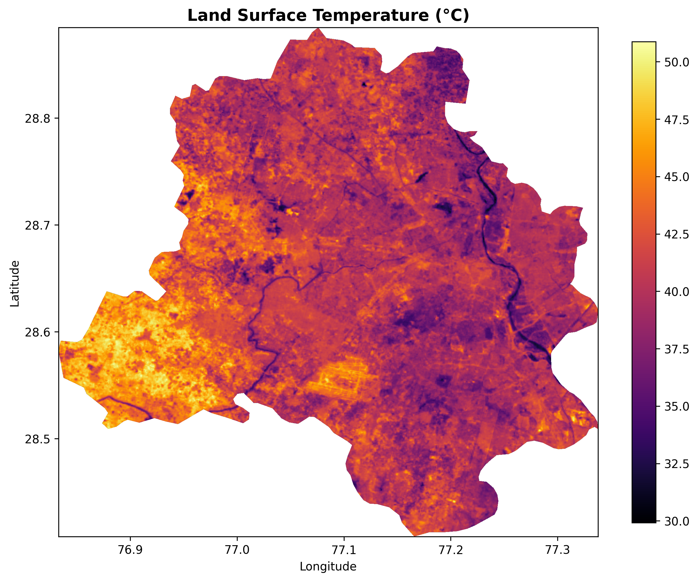
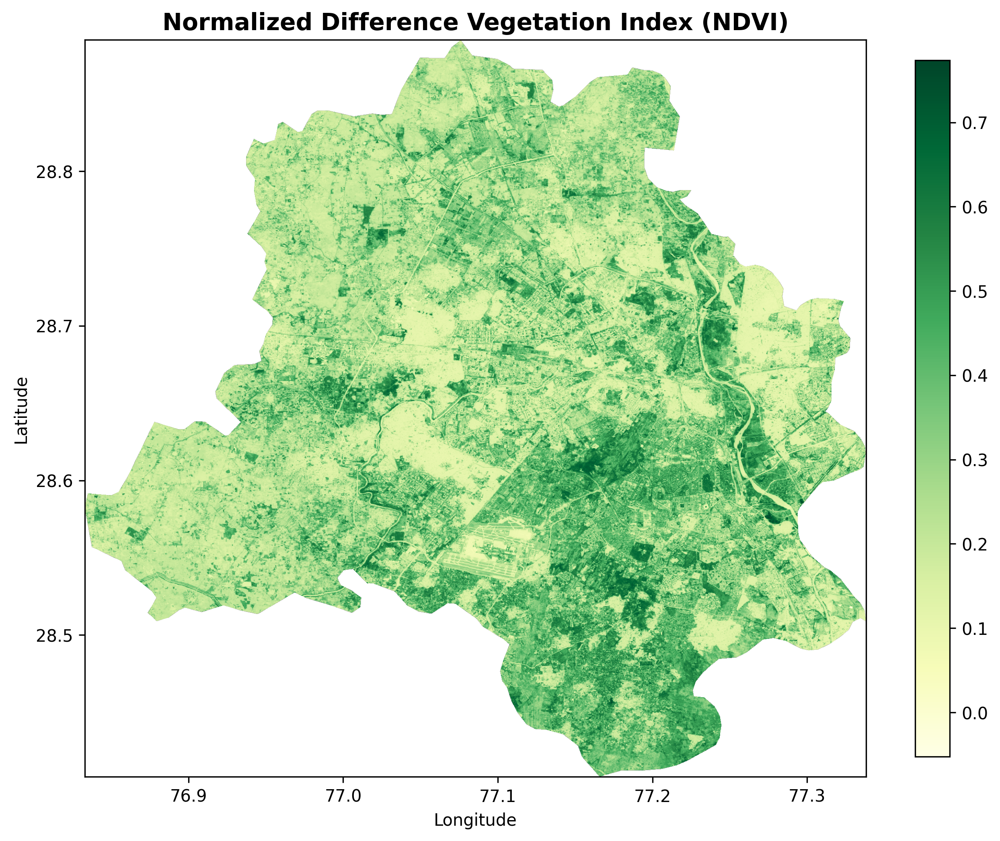
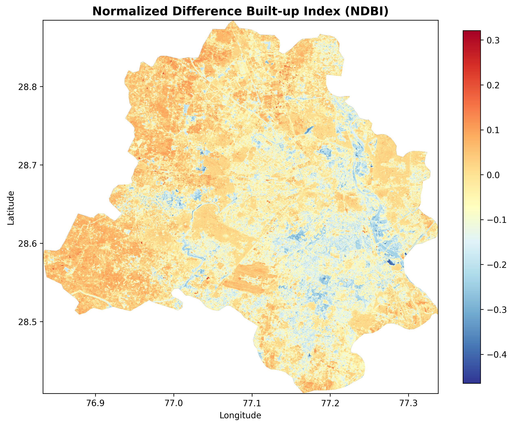

# Urban Heat Island Analysis of Delhi

### Relationship Between Land Surface Temperature, Vegetation and Urbanization

## 1. Overview

This project investigates the spatial distribution of Land Surface Temperature (LST) across Delhi and examines its association with vegetation cover and built-up characteristics using satellite-derived spectral indices.

Landsat 8 Collection 2 Level-2 imagery for April–June 2025 was processed using Google Earth Engine. Python-based spatial and statistical analysis was subsequently performed to explore the relationships between LST, the Normalized Difference Vegetation Index (NDVI), and the Normalized Difference Built-up Index (NDBI).

## 2. Research Objective

To investigate how spatial variations in vegetation and built-up characteristics are associated with land surface temperature across Delhi.

## 3. Data and Tools

**Study area:** Delhi, India  
**Satellite data:** Landsat 8 Collection 2 Level-2  
**Study period:** 1 April – 30 June 2025

**Tools and libraries:**
- Google Earth Engine
- Python and Google Colab
- NumPy and Pandas
- Matplotlib and Seaborn
- Rasterio
- Statsmodels and Scikit-learn

## 4. Methodology

### 4.1 Land Surface Temperature (LST)

Land Surface Temperature was derived from the Landsat 8 thermal band (ST_B10) using the Collection 2 Level-2 scale factor and offset.

LST (°C) = (ST_B10 × 0.00341802 + 149) − 273.15

### 4.2 Normalized Difference Vegetation Index (NDVI)

NDVI was calculated using scaled near-infrared (NIR) and red surface reflectance:

NDVI = (NIR − Red) / (NIR + Red)

Higher NDVI values generally indicate greater vegetation cover.

### 4.3 Normalized Difference Built-up Index (NDBI)

NDBI was calculated using scaled shortwave-infrared (SWIR) and near-infrared (NIR) surface reflectance:

NDBI = (SWIR − NIR) / (SWIR + NIR)

Higher NDBI values generally indicate stronger built-up characteristics, although the index is not an exclusive measure of urban land cover.

### 4.4 Spatial and Statistical Analysis

The exported raster datasets were aligned to a common spatial grid and combined for pixel-level analysis.

The following statistical methods were applied:
- Descriptive statistical analysis
- Pearson correlation analysis
- Simple linear regression
- Multiple linear regression
- Quartile-based analysis

## 5. Key Results

| Parameter | Result |
|---|---:|
| Mean LST | 40.67 °C |
| Mean NDVI | 0.297 |
| Mean NDBI | -0.038 |
| NDVI–LST correlation | -0.463 |
| NDBI–LST correlation | +0.645 |
| Multiple regression R² | 0.427 |

### Interpretation

- NDVI exhibited a moderate negative association with LST (r = -0.463), suggesting that areas with greater vegetation cover tended to have lower surface temperatures.
- NDBI showed a positive association with LST (r = +0.645), indicating that areas with stronger built-up characteristics tended to have higher surface temperatures.
- NDBI demonstrated a stronger individual linear association with LST than NDVI.
- The multiple regression model incorporating NDVI and NDBI explained approximately 42.7% of the observed variation in LST.

## 6. Spatial Visualisations

### Land Surface Temperature

### Vegetation Distribution (NDVI)

### Built-up Characteristics (NDBI)

### Statistical Visualisations

See the `figures/` directory for the correlation heatmap, regression plots and quartile analysis visualisations.

## 7. Limitations

- The analysis is restricted to the April–June 2025 observation period.
- Satellite-derived LST represents surface temperature, not near-surface air temperature.
- Spatial autocorrelation between neighbouring pixels may violate the independence assumption of conventional ordinary least squares regression.
- Consequently, regression coefficients and explanatory power are interpreted cautiously, without relying solely on conventional p-values.
- The analysis identifies statistical associations and does not establish causal relationships.
- A comparison with suitable rural reference areas would be required for a more direct assessment of urban heat island intensity.

## 8. Conclusion

The analysis identifies meaningful spatial associations between land surface temperature, vegetation and built-up characteristics across Delhi. The observed negative association between NDVI and LST and positive association between NDBI and LST highlight the relevance of vegetation and urban surface characteristics in understanding spatial variations in surface heating.

## 9. Repository Contents

- `Delhi_UHI_Analysis.ipynb` – Python-based spatial and statistical analysis.
- `gee/landsat_processing.js` – Google Earth Engine processing script.
- `figures/` – Spatial maps and statistical visualisations.

